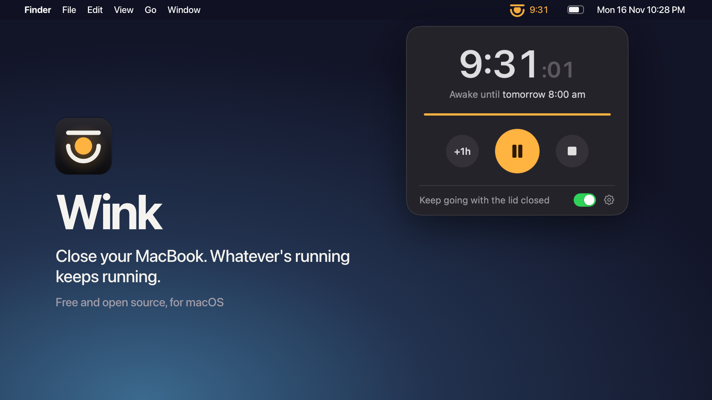
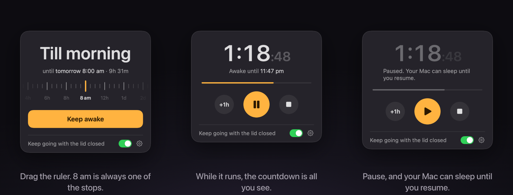
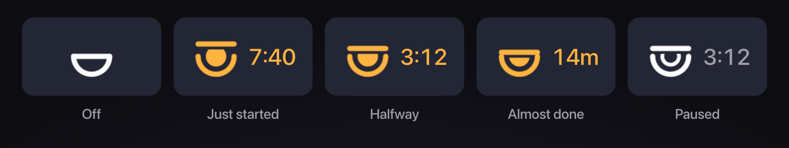

<p align="center">
  
</p>

<h1 align="center">Wink</h1>

<p align="center">
  Close your MacBook and whatever's running keeps running.<br>
  A menu bar app that keeps your Mac awake, lid open or shut, for exactly as long as you choose.
</p>

<p align="center">
  <a href="https://github.com/pavan-not-found/wink/releases/latest/download/Wink.dmg"><b>Download for macOS</b></a>
  &nbsp;·&nbsp; macOS 14 or later &nbsp;·&nbsp; Apple silicon and Intel &nbsp;·&nbsp; Free and open source
</p>

<p align="center">
  
</p>

## Why this exists

You start a long download, a render, a voice recording or a coding agent. Then you need to move, and the moment the lid shuts, macOS puts everything to sleep. So you carry the laptop half open, or you run `sudo pmset disablesleep 1`, forget about it, and your Mac never sleeps again.

Wink does it from the menu bar. Drag the ruler to choose how long, press Keep awake, and close the lid. When the time runs out, your Mac goes back to sleeping normally.

<p align="center"></p>

## Install

Paste this into Terminal:

```sh
curl -fsSL https://raw.githubusercontent.com/pavan-not-found/wink/main/scripts/install.sh | bash
```

Or download the DMG from [Releases](https://github.com/pavan-not-found/wink/releases/latest) and drag Wink into Applications. Wink isn't notarized by Apple yet, so the first time you open it, right-click the app and choose Open. The install script handles that for you.

## What it does



- **One ruler for every duration.** Fifteen minutes to a week, plus forever. There's always a stop for 8 am, so leaving it on overnight is one drag.
- **It tells you when it ends.** "Until 11:40 pm" instead of "2 hours".


- **The icon is the timer.** An eye under a lid. While Wink runs, the eye is amber and the lid slowly comes down as the time runs out. When it's shut, your Mac sleeps normally.
- **Pause, resume, or add an hour** without starting over.
- **It lets go on its own.** It stops early if your battery drops below 15% (you pick the number) or your Mac gets critically hot.
- **It fixes the forgotten `pmset` command.** If your Mac has been set to never sleep, Wink notices and offers to turn normal sleep back on.

## How it keeps a closed Mac awake

With the lid open, Wink holds a standard macOS power assertion, the same thing `caffeinate` does. No permissions needed.

With the lid closed on battery, macOS ignores assertions. The only switch that works is `pmset disablesleep`, and that needs admin rights. So the first time you use lid-closed mode, Wink asks for your password once and adds this file:

```
# /etc/sudoers.d/wink
you ALL=(root) NOPASSWD: /usr/bin/pmset -a disablesleep 0, /usr/bin/pmset -a disablesleep 1
```

It lets Wink run those two exact commands without asking again, and nothing else. You can remove it any time from Settings, or with `sudo rm /etc/sudoers.d/wink`.

Wink switches sleep back on when the timer ends, when you pause or stop, and when you quit. If Wink crashes or is force-quit, a small watcher process notices within two seconds and switches sleep back on. For the rare hard shutdown, Wink also adds a tiny login check (macOS will mention a new background item) that does the same the next time you log in. If something else turned off sleep before Wink started, Wink leaves it alone.

## Use it from the terminal, Shortcuts or agent hooks

Wink responds to `wink://` links, and the install script adds a small `wink` command:

```sh
wink start 2h          # 2h, 90m, 1d, 1w, 2h30m, forever
wink until 08:00
wink pause | resume | stop | toggle
wink extend 1h
```

Without the command, `open -g "wink://start?for=2h"` does the same thing.

**Keep your Mac awake while Claude Code works, and let it sleep when it's done.** Add this to `~/.claude/settings.json`:

```json
{
  "hooks": {
    "UserPromptSubmit": [{ "hooks": [{ "type": "command", "command": "open -g 'wink://start?for=forever'" }] }],
    "Stop": [{ "hooks": [{ "type": "command", "command": "open -g 'wink://stop'" }] }]
  }
}
```

## Keyboard

With the popover open: left and right arrows move the ruler, Return starts, Space pauses and resumes.

## Questions

**Why not just use `caffeinate`?** It works while the lid is open. On battery, closing the lid puts the Mac to sleep regardless.

**Will my laptop get hot in a bag?** Warmer than when it's asleep, yes. Wink stops if macOS reports critical heat, and the battery limit keeps it from running flat. For long runs, leave it somewhere with a bit of airflow.

**How is this different from Amphetamine?** Amphetamine is excellent and does far more. Wink does one thing with one gesture, and it's open source, so you can read exactly what it changes on your system.

**Does it collect anything?** No. It makes no network requests.

## Build from source

```sh
git clone https://github.com/pavan-not-found/wink.git && cd wink
scripts/build.sh          # builds dist/Wink.app, a zip and a dmg
open dist/Wink.app
```

You need Swift 6 (Xcode 16, or the Command Line Tools). `scripts/selftest.sh` drives a running copy through every state and checks the power assertions each time.

## Uninstall

Quit Wink from its Settings, then:

```sh
rm -rf /Applications/Wink.app
sudo rm -f /etc/sudoers.d/wink
rm -f ~/Library/LaunchAgents/app.wink.mac.restore-sleep.plist
defaults delete app.wink.mac
```

## License

MIT
